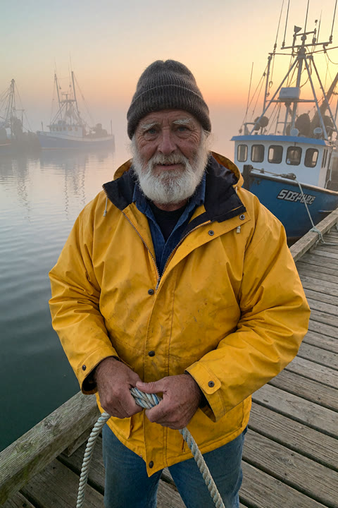
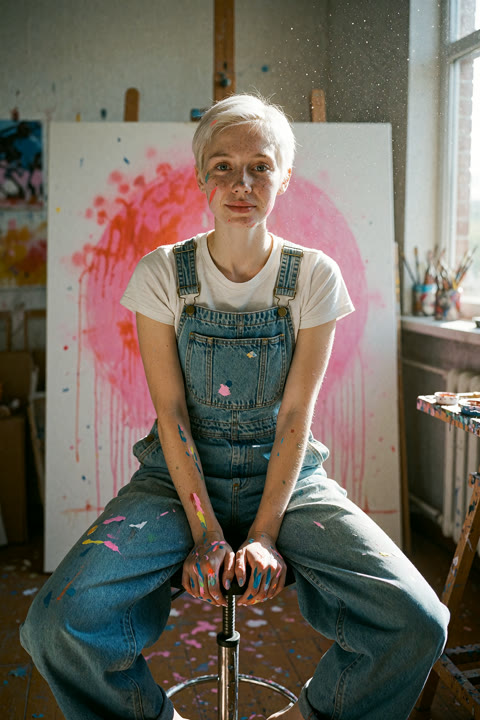
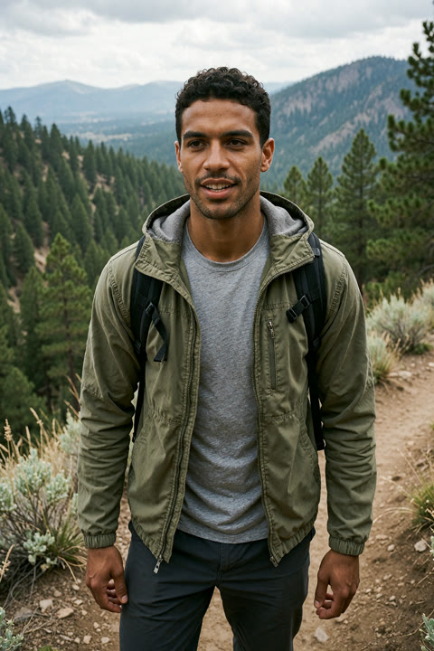
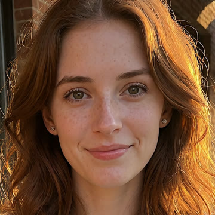
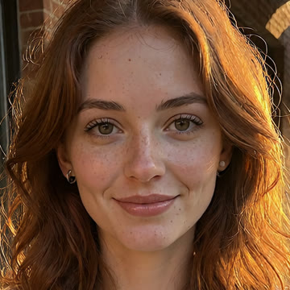
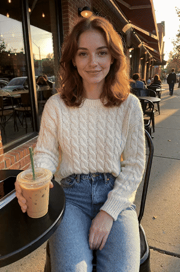

# photoreal

Photoreal people, men and women, as stills and short clips, rendered on any ComfyUI server
from a plain TOML shot list.

```
photoreal render examples/shots.toml --comfy http://my-gpu-box:8188
```

<p>
  
  
  
  
</p>

All made-up people, each the only seed rendered for its shot, straight out of the CLI with no
retouching. About a minute each on one GPU.

For every shot × seed you get:

| file | what it is |
|---|---|
| `out/<shot>/s<seed>_pass1.png` | pass 1: the whole frame, no face details in the prompt |
| `out/<shot>/s<seed>.png` | pass 2: same frame, largest face redrawn with the full description |
| `out/<shot>/s<seed>.mp4` | 3 s clip from the final still (only for shots with `[shot.video]`) |

## Why two passes

When a prompt has face details in it ("green eyes, full lips, beauty mark under the left eye"),
the model gives the face as much of the frame as it can. You get a close-up, often a from-above
selfie, even when you asked for "photographed by a friend, head to knees". Take the face phrases
out and the framing does what the scene asks, but the face comes out generic.

So the face is split off:

1. **Pass 1** renders `subject + scene`: the framing, pose, light and clothes come out right.
2. **Pass 2** detects faces, keeps only the **largest**, and redraws that crop at denoise 0.5 with
   `subject + face + scene`. Half the noise is enough to set the eyes, brows and skin, but not
   enough to move the head or change the light on it.

<p>
  
  
</p>

Pass 1 (left) and the face fix (right), same frame: the eyes sharpen, the brows take the
arch from `face`, and the hair, light and head position don't move.

Two details matter:

- **Largest face only.** A detailer that redraws every face gives everyone in the background
  your subject's face.
- **Write the camera into the scene.** "Photographed by a friend at eye level" or "candid phone
  photo" sets the framing; "full body" or "wide shot" on their own still land thighs-up from above.

## Clips

Wan 2.2 image-to-video 14B (high-noise then low-noise expert, lightx2v 4-step LoRAs, 4 steps,
cfg 1) animates the final still at 720×1088, 16 fps. Keep the motion small: blinks, breathing,
hair in the wind, a still camera. Big head turns are where the face drifts away from the still.



About 4 minutes per clip on one GPU.

## Shot list

```toml
[defaults]
seeds = [101, 102]
face_denoise = 0.5        # 0.3 keeps pass 1's face, 0.6+ follows `face` more

[[shot]]
name = "trail-man"
subject = "35 year old man, short dark curly hair, light stubble, medium brown skin, athletic build"
face = "dark brown eyes, thick brows, strong jaw, relaxed expression"
scene = "standing on a hiking trail overlook, olive field jacket, overcast soft light, photographed by a friend a few steps away, waist up"
lora = { name = "my_character.safetensors", strength = 0.6 }   # optional: same person every time

[shot.video]              # optional
motion = "he breathes steadily and glances toward the camera, wind moves his jacket slightly, camera completely still"
length = 49               # frames, 4k + 1
```

Full example with four people: [`examples/shots.toml`](examples/shots.toml). Re-running skips
files that already exist, so a long list can be stopped and resumed. Delete a file to redo it.

## Setup

Needs a ComfyUI with [Impact Pack](https://github.com/ltdrdata/ComfyUI-Impact-Pack) and
[Impact Subpack](https://github.com/ltdrdata/ComfyUI-Impact-Subpack) (face detector), plus
these files in ComfyUI's `models/` folders:

| folder | file |
|---|---|
| `diffusion_models/` | `gonzalomoKrea2_v20_fp8.safetensors` (GonzaLomo Krea2 v2.0) |
| `text_encoders/` | `qwen3vl_4b_fp8_scaled.safetensors` |
| `vae/` | `wan_2.1_vae.safetensors` |
| `ultralytics/bbox/` | `face_yolov8m.pt` |
| `diffusion_models/` | `wan2.2_i2v_high_noise_14B_fp8_scaled.safetensors`, `wan2.2_i2v_low_noise_14B_fp8_scaled.safetensors` |
| `loras/` | `wan2.2_i2v_lightx2v_4steps_lora_v1_high_noise.safetensors`, `wan2.2_i2v_lightx2v_4steps_lora_v1_low_noise.safetensors` |
| `text_encoders/` | `umt5_xxl_fp8_e4m3fn_scaled.safetensors` |
| `clip_vision/` | `clip_vision_h.safetensors` |

The last four rows are only needed for clips. Check each model's license before you use its
output commercially.

Build: `cargo build --release` (Rust stable). The server comes from `--comfy`, then
`PHOTOREAL_COMFY`, then `http://127.0.0.1:8188`.

## Workflows for the ComfyUI GUI

- [`workflows/image_two_pass.json`](workflows/image_two_pass.json): the two-pass still. Drag it
  onto the canvas; each node's title says what it's for.
- [`workflows/video_wan22_i2v_api.json`](workflows/video_wan22_i2v_api.json): the clip graph in
  API format (`photoreal export video`). Load it with *Workflow → Open*.

## Use

Made-up people only. Don't use this to depict real people without their consent.

MIT licensed.
